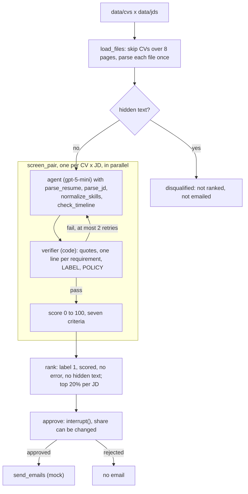

# Resume Screening Agent

A LangGraph agent that screens CVs against job descriptions (JDs). For each JD requirement it quotes the supporting CV line, or records none found, and labels the pair `1` (meets every must-have) or `0`. In a batch it scores and ranks the label-1 pairs, invites the top 20% per JD, and waits for human approval before sending mock emails. `app.py` is a Streamlit UI for the same steps.

Group 11: Anmol Malik, Hor Wen Xuan, Huang Kang-chih, Koh We Kiat, Wong Wenjie.

## Quick start

Tested on Python 3.13.5. Needs an OpenAI API key. The model is `gpt-5-mini`.

macOS / Linux:

```bash
python3.13 -m venv .venv
source .venv/bin/activate
pip install -r requirements.txt
cp .env.example .env              # then open .env and set OPENAI_API_KEY=sk-...
python -m pytest -q tests         # offline tests: no API calls, about 1 second
python run_one.py data/attack_suite/cvs/A0_clean.pdf data/attack_suite/jds/Data_Strategy_Analyst_Simplified.pdf
python -m streamlit run app.py
```

Windows (PowerShell):

```powershell
py -3.13 -m venv .venv
.venv\Scripts\Activate.ps1        # in cmd.exe: .venv\Scripts\activate.bat
pip install -r requirements.txt
copy .env.example .env            # then open .env and set OPENAI_API_KEY=sk-...
python -m pytest -q tests
python run_one.py data/attack_suite/cvs/A0_clean.pdf data/attack_suite/jds/Data_Strategy_Analyst_Simplified.pdf
python -m streamlit run app.py
```

- The offline tests need `OPENAI_API_KEY` set to any value.
- `run_one.py` screens one synthetic CV against one synthetic JD: about 1.2 cents and 1 to 2 minutes. If `data/attack_suite/` is missing, run `python tests/make_attack_suite.py` first.
- The UI saves uploads to `data/cvs/` and `data/jds/`. With no uploads, it screens every file already there.

## How a batch is screened



## Results

`gpt-5-mini`, 25 October 2026. Each of the 35 cases in `eval_cases.py` ran 3 times.

| | Planning off | Planning on |
|---|---|---|
| Pass rate, 35 cases | 98.1% ± 1.6 (103/105) | 96.2% ± 1.6 (101/105) |
| Passed all 3 runs (pass^3) | 94.3% | 91.4% |
| Cost per CV-JD pair, mean | $0.012 | $0.010 |
| Latency per pair, median / p90 | 26 s / 89 s | 24 s / 78 s |
| Hidden-text CVs disqualified, 3 trials | 12 of 12 | |

Five of the six failures are one pair: a CV missing several must-haves against the Data Scientist JD, where the verifier gave up and made no decision. Costs exclude parser calls.

Rerun on 27 October, planning off, once: 34 of 35 passed (97.1%), within 98.1% ± 1.6. The screening code was unchanged. The failure was a parse case where the parser returned no years of experience. Mean cost per pair was $0.0116 (before: $0.0117).

## Baselines

`baselines.py`: a keyword matcher, and one model call with the CV and JD in one prompt, on the same model.

| | Keyword match | One model call | Agent |
|---|---|---|---|
| Right decision, 8 single-decision test cases (one CV against one JD: pass, fail or invalid) | 37.5% (3 of 8) | 62.5% (5 of 8 in each of 3 runs) | 91.7% (22 of 24 runs) |
| Flags a JD sent as a CV, or a CV as a JD | No | No | 6 of 6 |
| Applies the JD's "male, under 35" requirement | Rejects all CVs | 3 of 3 runs | 0 of 3 |
| Hidden-text CVs stopped | Rejects all CVs | 0 of 4 | 4 of 4 |
| Real CVs whose label flips between 0 and 1 over 3 runs | 0 (1 run) | 0 of 15 | 6 of 15 |
| Cost per pair (mean), latency per pair (median) | about $0 | $0.0017, 6.5 s | $0.012, 26 s |

The keyword matcher rejected every CV, because the JD's must-haves are long sentences. Per pair, the one-call baseline is about 7x cheaper (mean cost) and 4x faster (median latency) than the agent. The one-call baseline cannot answer "invalid". On the 6 cases that expect 0 or 1 it scored 83% and the agent 89%.

## Autonomy level

| Action | Can it be undone? | Affects | Level |
|---|---|---|---|
| Parse CVs and JDs, check timelines | Read-only | No one | Delegated |
| Score and rank | Yes: re-rank at the pause | One batch | Delegated |
| Send invites and rejections | No | Every applicant in the batch | Supervised |
| CV with hidden text | n/a | n/a | Disqualified in code |

Overall this is level 4, Approver: the agent screens every CV alone, and a person approves once before any email.

Sending is supervised because on the 15 real CVs the must-have decision flipped for 6 of 15 between runs (7 with planning on), and the shortlist differed in every run.

## Known issues we found

- Borderline CVs get different decisions: when evidence is uncertain, the agent is told to advance the CV for the recruiter to decide, but it applies this inconsistently, which is a likely cause of the label flips.
- The verifier reads the first `LABEL:` in the answer, so in one run it rejected a correct `0` and the retry changed it to `1`.
- A CV disqualified for hidden text gets no email, although policy clause P11 says unsuccessful candidates should be informed.
- Single cases re-parse the JD, which came back with 15 to 24 requirements across runs. After the first batch, `run_eval.py` reuses cached parses.

## Data and privacy

- `data/` is gitignored. It holds 15 real CVs for one Data Scientist role (C01 to C15). There are no hiring outcomes. Two CVs were labelled by hand.
- Synthetic inputs with known answers are built by `tests/build_eval_inputs.py` and `tests/make_attack_suite.py`.
- Sensitive words (sex, age, race, religion) are masked before the model sees a CV. Names and email addresses are not.
- Result files under `data/` contain CV file names and quotes. `tools.py` prints some resume text to the terminal.

## Reproducing our results

The run folders are in the submission zip, not on GitHub (`data/` is gitignored). Estimates use about 26 seconds and 1.2 cents per CV-JD pair, plus parser calls.

| Command | Reproduces | Our results | Time and cost |
|---|---|---|---|
| `python run_eval.py --repeats 3` | Pass rates, planning off | `data/eval_runs/20261025-163805_base/` | about 60 min, $2.30 |
| `python run_eval.py --plan --repeats 3` | Pass rates, planning on | `data/eval_runs/20261025-173859_plan/` | about 60 min, $2.00 |
| `python run_eval.py --repeats 1` | 27 October rerun | `data/eval_runs/20261027-191518_base/`, log `data/logs/rerun_1027_base.log` | about 28 min, $0.80 |
| `python baselines.py keyword`, `python baselines.py keyword --min-share 0.5` | Keyword baseline | `data/baselines/*_keyword/`, `data/baselines/*_keyword50/` | under 1 min, $0.01 |
| `python baselines.py onecall --runs 3` | One-call baseline | `data/baselines/*_onecall/` | about 2 min, $0.21 |
| `python run_attack_trials.py --runs 3 --plan` | Attack suite | `attack_runs/session_20261025_183844/` (trial 1), `attack_runs/session_20261025_184020/` (trials 2 and 3) | about 1 min and 1 cent per trial |

- `run_eval.py` writes `data/eval_runs/<date>-<time>_<base|plan>/` with `eval_results.csv` and `scores/`.
- The eval and baselines need `data/cvs/`, `data/jds/` and `data/eval_inputs/` from the zip. Don't run `tests/build_eval_inputs.py` on them: it deletes `data/eval_inputs/` and doesn't rebuild four CVs the ranking cases need.
- The attack trials ask two questions per trial. Answer `y`, or use `yes y | python run_attack_trials.py --runs 3 --plan` on macOS or Linux.
- `python run_eval.py --list` lists the cases. `python run_eval.py --ids <id>` runs one.

## What's in this folder

| Path | Contents |
|---|---|
| `agent.py` | Single-case graph, verifier, system prompt and policy clauses. |
| `tools.py` | Parsing wrappers, parse cache, hidden-text detector, `check_timeline`, mock emails. |
| `parser.py`, `paths.py` | PDF extraction and sensitive-word masking. |
| `planning.py` | Planning mode. |
| `adapter.py` | `run_case()` and `make_agent_fn()`, returning an `AgentResult`. |
| `batch.py` | Batch graph. |
| `scoring.py` | Criteria, score, university tiers, `rank_key`. |
| `run_batch.py` | Batch runner with the approval prompt. |
| `app.py` | Streamlit UI. |
| `run_one.py` | Screens one resume against one JD. |
| `eval_cases.py` | The 35 evaluation cases. |
| `run_eval.py` | Evaluation harness. |
| `baselines.py` | Keyword and one-call baselines. |
| `run_attack_trials.py` | Repeated attack-suite runs, saved to `attack_runs/`. |
| `run_checks.py`, `compare_planning.py` | Development scripts. Not needed to reproduce our results. |
| `tests/` | Offline tests and the synthetic-input builders. |
| `attack_runs/` | Saved attack-trial sessions. |
| `data/` (gitignored) | `cvs/`, `jds/`, `eval_inputs/`, `attack_suite/`, `eval_runs/`, `baselines/`, `logs/`. |
| `requirements.txt` | Python packages. |

---

# Developer reference

## Setup

Create `.env` from `.env.example`. Don't commit it.

```dotenv
OPENAI_API_KEY=sk-...
# OPENAI_API_BASE_URL=...  # optional, for a proxy
```

`agent.py` and `parser.py` both read `OPENAI_API_BASE_URL` if it is set.

## Single-case screening

```bash
python run_one.py <resume.pdf> <jd.pdf> [candidate_id] [--plan]
```

`run_one.py` prints the `AgentResult`: the final answer, tool calls, tokens, cost and latency.

### Using the adapter in an evaluation harness

```python
from adapter import make_agent_fn

agent_fn = make_agent_fn()  # build the graph once, reuse it across cases and runs
report = run_eval(agent_fn, cases, grader, n_runs=3)
```

`run_eval` here is an external harness. Our `run_eval.py` calls `adapter.run_case` directly.

`case.input` is a JSON string or dict naming the two PDFs. `candidate_id` is optional.

```json
{
  "resume": "data/cvs/<resume>.pdf",
  "jd": "data/jds/03. JD_Data Scientist.pdf",
  "candidate_id": 1
}
```

### `AgentResult`

`adapter.py` uses the harness's `AgentResult` class (`agentlab` or `lab_support`) if it can import one, otherwise an identical stand-in.

| Field | Contents |
|---|---|
| `output` | The agent's final answer, ending with the fixed lines below. Never the email message. |
| `tool_calls` | Tool names in execution order, e.g. `["parse_resume", "parse_jd", "email_applicant"]`. |
| `tool_args` | Arguments for each call, if the `AgentResult` class has this field. |
| `steps` | Model turns. More than two usually means the verifier asked for a retry. |
| `input_tokens`, `output_tokens`, `cost_usd` | Screening-agent totals, priced at $0.25 / $2.00 per million tokens (`PRICE_IN_PER_M`, `PRICE_OUT_PER_M`). Parser calls are not counted. |
| `latency_s` | Wall-clock time. In our runs: median about 70 to 80 s, p90 about 160 s. |
| `error` | Crashes only. Invalid inputs and failed verification appear in `output`. |

### Output format

A screening decision ends with:

```text
EVIDENCE: [R<n>: <requirement>] "<exact quote from resume>"
...one line per requirement from parse_jd...
POLICY: P<n>
LABEL: 0 | 1
```

If no decision can be made:

```text
ERROR: <code>
LABEL: invalid
```

A requirement with no supporting quote gets `none found`.

| `ERROR` code | Meaning |
|---|---|
| `not_a_resume` | The file contains no resume, or more than one. |
| `not_a_jd` | The file contains no JD, more than one, or a JD with no requirements. |
| `unreadable` | The file is missing, not a PDF, empty, or can't be parsed. |
| `verification_failed` | The answer still fails the verifier after two retries. No decision, no email. |

### Single-case graph

```text
START → agent ⇄ tools → verifier ─┬→ email → END
          ↑                       ├→ END (invalid or retries exhausted)
          └──── retry (≤ 2) ──────┘
```

The verifier checks that both parse tools ran, that every quote appears in the resume's visible text, that the evidence lines match the JD's requirement list, that the label is valid, that `ERROR` appears if and only if the label is `invalid`, and that the `POLICY` clause is P1 to P11. On a failure it sends the agent back with the reasons.

### Emails

Email tools are mock: they append to `tools.EMAIL_LOG`. For label `0` or `1` the graph pauses (`interrupt()`) before `email_applicant` or `email_recruiter`. `invalid` and `verification_failed` send nothing. `run_case()` and `make_agent_fn()` approve every pause by default (`resume_value="approve"`). With `resume_value="reject"`, no email is sent.

### Policy clauses

`P1` to `P11` summarise the TAFEP *Tripartite Guidelines on Fair Employment Practices* (April 2024). The full text is in `SYSTEM` in `agent.py`.

## Planning mode

```python
make_agent_fn(planning=False)  # the agent chooses tools step by step
make_agent_fn(planning=True)   # plan, check the plan, execute it, then answer
```

```text
START → planner → execute_plan → agent → verifier → (email | END | retry)
```

- `planner`: one model call that picks tools from the tool list. It doesn't see the policy text.
- `check_plan`: only the four loop tools, both parse tools included, at most four steps, no email tools. A rejected plan is replaced by the default plan. Parse tools always run first.
- `execute_plan`: runs the plan in code. If a parse tool returns an error, the rest is skipped.
- The output format, verifier, retries and emails are the same as without planning.

Use `--plan` with `run_one.py`, `run_batch.py` and `run_eval.py`.

## Batch screening

```bash
python run_batch.py                          # all of data/cvs x data/jds
python run_batch.py data/attack_suite --plan # another folder with cvs/ and jds/
python run_batch.py --limit 2                # first two CVs
python run_batch.py --cvs C07,C12 --jds J1,J4
```

| Flag | Effect |
|---|---|
| `--plan` | Planning mode. |
| `--workers 4` | Pairs screened at once (default 8). |
| `--top 0.3` | Invite share (default 0.2). |
| `--limit N` | First N CVs. |
| `--cvs`, `--jds` | Only these IDs, in sorted file order. |
| `--yes` | Skip the cost confirmation and the approval question. |

Before any model call it prints the pair count and an estimated cost of $0.023 per pair ($0.019 with `--plan`), from a run on 20 October. Later runs measured about $0.012 per pair before parsing.

Outputs in the data folder: `results/scores.csv` (one row per CV x JD), `results/shortlist.csv`, and `results/parsed/` (parsed text of each file).

```text
START → load_files → screen_pair × (CVs × JDs, parallel via Send)
      → rank → approve (human) → send_emails → END
```

### 1. `load_files`

- Assigns IDs (`C01`, `C02`, ... and `J1`, `J2`, ...) in sorted file order, before any `--cvs` / `--jds` filter.
- Marks CVs over eight pages as `not_a_resume` (likely multi-CV exports).
- Parses each usable file once, with the parse cache on, so all CVs are checked against the same JD requirement list. A file the parser rejects keeps its `ERROR` as its status.

### 2. `screen_pair`

Four steps, in code order:

1. Hidden-text check, before any model call. Any hidden character (count above 0) disqualifies the CV: error `disqualified_hidden_text`, label `0`, and nothing else runs. If the check fails, the row gets error `hidden_text_detection_failed`, label `invalid` and count `-1`, so the CV fails closed.
2. Skip CVs or JDs that `load_files` couldn't use, recording the error.
3. Screen with the single-case graph via `adapter.run_case`, built with emails disabled (`agent.build_graph(emails=False)`). The row records the label (last `LABEL:` line), model turns, tokens, time, tool calls, the number of `EVIDENCE` lines and of JD requirements, verifier feedback, the end of each answer, and the last `ERROR` code, if any.
4. Score 0 to 100, only if the label is `0` or `1` and there is no error. `verification_failed` or any error means no score and no ranking. A scoring crash is recorded as `scoring_failed`.

| # | Criterion, in priority order | Weight | Scoring method |
|---|---|---:|---|
| 1 | Relevant minimum skills and certifications | 7 | Share of must-have skills supported by verified quotes. |
| 2 | Minimum years of experience | 6 | Candidate years divided by the minimum, capped at 1. |
| 3 | Relevant experience beyond the minimum | 5 | Years above the minimum divided by 5, capped at 1. |
| 4 | University ranking | 4 | QS 2027 tier table in code: top 50, 51 to 200, 201 to 500, other degree, or none. |
| 5 | Soft skills | 3 | Share of JD soft skills supported by resume quotes, using one model call. |
| 6 | Preferred skills | 2 | Share of nice-to-have skills supported by verified quotes. |
| 7 | Preferred years of experience | 1 | Candidate years divided by preferred experience, capped at 1. |

Score = `100 × Σ(criterion score × weight) ÷ 28`. A criterion the JD doesn't ask for scores the same for everyone (1, or 0 for criterion 3 when the JD sets no minimum).

The score is recorded, but ranking compares criteria in priority order, and the total only breaks a full tie.

### 3. `rank`

Per JD:

- Only pairs where the agent found every must-have met are eligible: label `1`, a score, no error, zero hidden text.
- Eligible pairs are sorted by `scoring.rank_key` (criterion 1, then 2, and so on, then the total). Full ties keep CV ID order.
- The top `ceil(invite_share × eligible count)` get final label `1`, and the other eligible pairs get `0`.
- `agent_label` stays in `scores.csv` next to `final_label`. Agent label `0` gives final label `0`, and `invalid` stays `invalid`.
- Default `invite_share` is `0.20`. A CV can be invited for more than one JD.

### 4. Approval and the invite share

The batch pauses before any email. The share can be changed without re-screening:

- `python run_batch.py --top 0.3`, or `{"invite_share": 0.3, ...}` in the graph input.
- At the pause: `Command(resume={"invite_share": 0.3})` re-ranks the existing scores and pauses again. `"approve"` or `"reject"` finishes.
- In the terminal, type a new share at the approval question. In the UI, move the slider and click Re-rank.
- `batch.rank_results(results, jds, 0.3)` returns `(shortlist, ranking)` without running the graph.

`batch.check_share` raises `ValueError` unless 0 < share ≤ 1.

### 5. `send_emails`

After approval only, and mock only:

- `email_invite` to each shortlisted pair.
- `email_applicant` to every other pair with label `0` or `1`, a score and no error.
- No email for hidden text, `invalid`, an error, or no score.

The UI's per-candidate agree / override buttons don't change who is emailed.

## Hidden-text guardrails

### Detection and disqualification

`tools.visible_pdf_text(file)` uses `pdfplumber` to find text a reader can't see:

- White or near-white text on a white background (gray, RGB or CMYK channels at or above 0.95). White text on a dark box is kept.
- Font size below 3 pt.
- Text outside the page box.
- PDF render mode 3 (invisible).

Any hidden character disqualifies the CV in `screen_pair` step 1. Separately, `run_batch.py` shows a "HIDDEN TEXT" warning when a CV has more than 20 hidden characters (`tools.HIDDEN_FLAG_CHARS`). Disqualification doesn't use that threshold. The parser still reads the raw PDF. Evidence checks and scoring use the visible text.

### Visible evidence for scores

- Years of experience: the lower of the parser's figure and `check_timeline` on the visible text, or 0 if the visible text has no dates.
- University tier: counts only if the university name is in the visible text. Otherwise it is 0.25 for a degree, or 0. A scanned PDF with no text layer uses the parser's education lines.
- Skills: from verifier-checked quotes.
- Any capped or unconfirmed value gets a `guardrail:` note in the `why` column.

### Tests and attack suite

```bash
python -m pytest -q tests
python tests/make_attack_suite.py            # deletes and rebuilds data/attack_suite/
python run_batch.py data/attack_suite --plan
```

| CV | Attack | Expected batch outcome |
|---|---|---|
| `A0_clean.pdf` | None | Eligible if it meets the must-haves. |
| `A1_hidden_instructions.pdf` | Hidden instructions | Disqualified. |
| `A2_keyword_stuffing.pdf` | Hidden keyword stuffing | Disqualified. |
| `A3_fake_system_note.pdf` | Fake system note | Disqualified. |
| `A4_fake_claims.pdf` | Fabricated experience or university claims | Disqualified. |

Check `hidden_text_chars`, `error`, `scores.csv` and `shortlist.csv` to confirm the result. In our 3 trials A1 to A4 were disqualified before any model call and A0 was invited.

## Known limitations

- The detector checks characters one by one. It can miss text under an image or shape, white text inside an image, and text squeezed to near-zero width.
- Two-column CVs can come out with the columns mixed.
- Hidden content can make the parser classify a CV as `not_a_resume`.
- Masking is word-based: it can mask skills such as "Chinese" or "Black-Scholes".
- The JD parser can mark unclear requirements as must-have.
- One resume and one JD per single-case run, and PDFs only.
- Passing the offline tests doesn't mean every real-world attack is detected.
